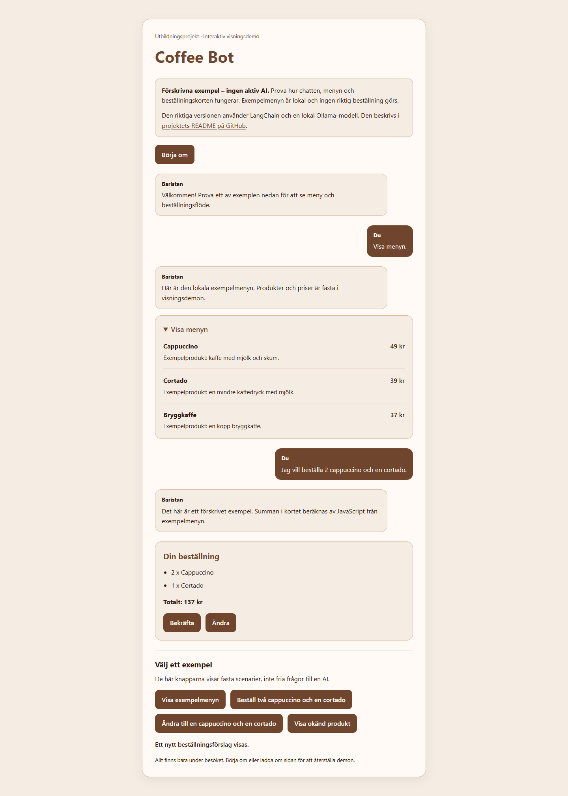
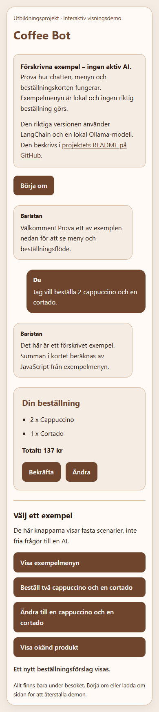

# Coffee Bot

En mindre caféchatbot som jag byggt som en skolövning i kursen Utveckling av AI-drivna webbapplikationer. Projektet utforskar hur ett chattgränssnitt kan kombineras med en lokal språkmodell, verktygsanrop och kontrollerade beställningsförslag.

**Utbildningsprojekt och prototyp.** Bekräftelser sker bara lokalt. Ingen beställning skickas till ett café och inga betalningar görs.

## Visningsdemo

Startsidan visar en interaktiv demo med **förskrivna exempel och en lokal exempelmeny**. Ingen aktiv AI används i det läget. Demon fungerar utan Ollama och externa API:er.

- Visa exempelmenyn.
- Skapa ett beställningsförslag för två cappuccino och en cortado.
- Ändra till ett nytt förslag och bekräfta lokalt.
- Visa ett exempel på en okänd produkt.
- Återställ med Börja om eller genom att ladda om sidan.

Exempelsvaren och produktvalen är fasta. Summan beräknas i JavaScript. Demon visar gränssnitt och interaktioner; den bevisar inte hur en språkmodell svarar på fria frågor. Historik och ändringar sparas bara i minnet under besöket.

**Publiceringsstatus:** Visningsdemon förbereds och verifieras lokalt. Publik demolänk läggs till efter publicering.

## Bilder





## Vad jag har arbetat med

- Chattgränssnitt med meddelandebubblor, menykort och beställningskort i React.
- Promptmallar, samtalshistorik och klassificering av meddelanden med LangChain.
- Strukturerad tolkning av beställningar med Zod och en lokal Ollama-modell.
- Verktyget `get_menu` för att hämta menyinformation när modellen behöver den.
- Kontroll av produktnamn mot menyn, gruppering av identiska produkter och prisberäkning i JavaScript.
- Vänteläge, felmeddelanden, inmatningsfokus och scroll i AI-versionen.
- Uppdelning i namngivna npm-workspace-paket med olika ansvar.

## Så fungerar den riktiga AI-versionen

AI-versionen använder Ollama och `qwen3:4b-instruct`. Fria meddelanden klassificeras som samtal eller beställning. Vid samtal kan modellen anropa `get_menu`. Vid beställning extraheras produkter och antal till ett strukturerat format; JavaScript kontrollerar produkterna mot menyn och räknar totalsumman.

En uttrycklig begäran att visa menyn hanteras direkt av appen. Bekräftelse av ett beställningskort sker också direkt i appen. Alla delar kräver alltså inte ett modellbeslut.

AI-versionens meny hämtas från [kursens menydata](https://santosnr6.github.io/Data/airbean.json). Visningsdemon använder en egen liten, fast exempelmeny och gör ingen menyhämtning.

## Kör lokalt

Använd Node.js 24. Kör från projektroten, där workspace-konfigurationen ligger:

```bash
npm ci
npm run dev
```

Öppna adressen som Vite visar för visningsdemon.

För den riktiga AI-versionen behövs även Ollama och modellen:

```bash
ollama pull qwen3:4b-instruct
ollama serve
```

Om Ollama redan körs behöver du inte starta en andra server. Öppna sedan Vite-adressen med `?mode=ai`, exempelvis `http://localhost:5173/?mode=ai`. AI-läget är endast åtkomligt på localhost. Den publika visningsdemon ansluter aldrig till besökarens Ollama.

Ollama måste tillåta frontendens lokala origin och datorn måste kunna köra modellen. Exponera inte den lokala modellservern på internet för att publicera demon.

```bash
npm run lint
npm run build
npm run preview
```

## Projektstruktur

- `src`: appstart och global stil.
- `packages/pages`: sammansatta vyer för AI-chatten och visningsdemon.
- `packages/shared`: chattformulär, meddelanden, meny och beställningskort.
- `packages/base`: gemensam knappkomponent.
- `packages/core/hooks`: chatthistorik och applikationsflöde.
- `packages/core/langchain`: modell, prompts, klassificering och verktyg.
- `packages/core/api`: hämtning av menydata.

## Begränsningar och verifiering

- Den publika visningsdemon är förskriven och kan inte svara på fria frågor.
- Modellens fria rekommendationer i AI-versionen kan avvika från instruktionerna. Produktkontroll i beställningsflödet är separat från fri chatttext.
- Ändring i AI-versionen kräver en ny komplett beställning; appen skapar ett nytt förslag.
- Ingen permanent historik, serverlagrad beställning, betalning eller riktig caféintegration finns.
- AI-versionens modell- och API-flöden är dokumenterade som manuellt testade under utbildningen i oktober. De körs inte på nytt inom arbetet med portfoliodemon.
- Visningsdemon verifieras separat med lokala webbläsartester. Det finns ingen permanent automatiserad testsvit.

## Publicera på Vercel

Projektet har en `vercel.json` för statisk publicering. Importera GitHub-repot `coffee-bot` och använd projektroten, inte en enskild workspace-mapp.

- Framework Preset: Vite.
- Root Directory: repots rot, där denna README och package.json finns.
- Install Command: `npm ci`.
- Build Command: `npm run build`.
- Output Directory: `dist`.
- Node.js: 24.x.
- Inga miljövariabler, AI-nycklar eller Ollama-server behövs för visningsdemon.

När publiceringen är klar läggs den riktiga Vercel-adressen in här. Den offentliga sidan är endast visningsdemon.
